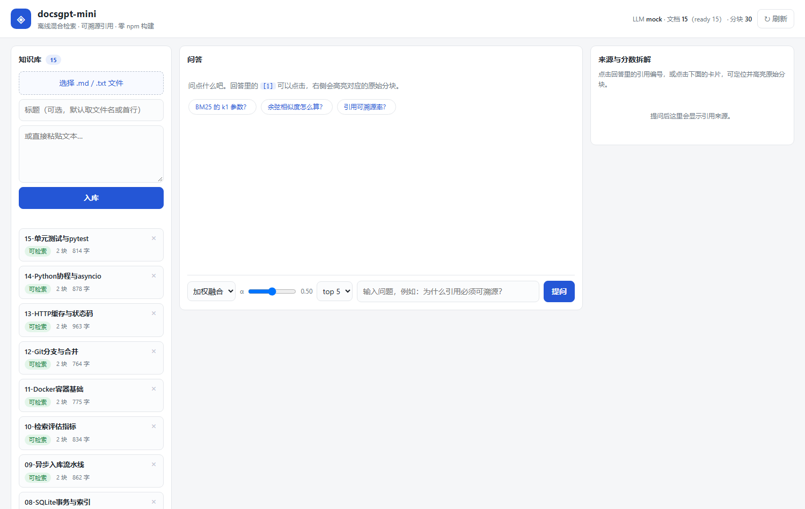

# docsgpt-mini

一个**完全离线、零 API key、零前端构建**的文档问答 MVP。上传或粘贴中文文档 → 异步流水线入库 → 自实现 BM25 + 确定性哈希向量的混合检索 → 带可溯源引用的回答 → 前端点击引用高亮原文分块。

> 本项目不是 DocsGPT 的 fork/clone，而是按公开架构思路从零实现的独立 MVP。默认端口 **8202**，打开 <http://127.0.0.1:8202/> 即可使用。

---

## 实测指标（本机，2026-11-13）

20 道中文问题，15 篇语料（30 个分块），`top_k=5`，`alpha=0.5`，mock LLM，`eval/eval.py` 真实跑出：

| 策略 | Recall@5 | 引用可溯源率 | 答案级可溯源率 | 平均延迟 | p50 | p95 | 平均检索延迟 | 平均引用数 |
|---|---|---|---|---|---|---|---|---|
| weighted（加权融合） | **1.00**（20/20） | **100.00%**（55/55 个 `[n]` 标记） | **100.00%** | **4.3 ms** | 3.6 ms | 5.6 ms | 0.8 ms | 2.75 |
| rrf（倒数排名融合） | **1.00**（20/20） | **100.00%**（55/55） | **100.00%** | **3.6 ms** | 3.6 ms | 4.1 ms | 0.3 ms | 2.75 |

- 延迟为**端到端** HTTP 请求耗时（含进程内检索 + mock 回答生成）；“平均检索延迟”只统计 BM25 + 向量打分 + 融合。数值会随机器负载波动，重跑会覆盖 `eval/results.json`。
- 指标口径见 [评估方法与结果](#评估方法与结果)；原始数据见 [eval/results.json](eval/results.json)。
- 诚实说明：语料与 20 道题由同一人编写，Recall@5 = 1.00 说明**检索链路功能正确、标注可复现**，不代表对任意真实语料的泛化能力（见[已知限制](#已知限制)）。

环境：Windows 11 · Python 3.12.2 · fastapi 0.162.5 · uvicorn 0.54.0 · httpx 0.28.1 · numpy 2.5.4。

---

## 快速开始

```powershell
# 在仓库根目录（deepseek/）下：
cd replicas\02-docsgpt-mini

# 方式 A：双击 start.cmd（会自动以 -ExecutionPolicy Bypass 调用 run.ps1）
# 方式 B：命令行启动
powershell -NoProfile -ExecutionPolicy Bypass -File .\run.ps1

# 打开浏览器
# http://127.0.0.1:8202/
```

- Python 解释器优先使用 `..\.venv\Scripts\python.exe`，其次找 PATH 中的 `python`/`py`。
- 依赖（已预装在共享 venv）：`fastapi`、`uvicorn`、`httpx`、`numpy`。如需重装：`.\run.ps1 -Install`（或 `python -m pip install -r requirements.txt`）。
- 首次启动自动建库 `data/app.db`（SQLite），无需额外初始化。当前 `data/app.db` 已入库 15 篇示例语料，打开即有内容可问；删掉该文件即可从空库开始。
- 一键跑评估（启动临时服务 → 入库 → 20 题 → 停服 → 打印/保存结果）：

```powershell
powershell -NoProfile -ExecutionPolicy Bypass -File .\run.ps1 -Eval
# 或：先启动服务，再执行
python eval\eval.py --base-url http://127.0.0.1:8202
```

- 单元级自检（纯逻辑：分块/分词/BM25/向量/融合/mock 回答，无需起服务）：`python tests\core_selftest.py`。

---

## 目录结构

```
02-docsgpt-mini/
├── app/
│   ├── main.py        FastAPI 入口：路由、静态页、入参校验
│   ├── config.py      环境变量配置（分块/检索/LLM/路径）
│   ├── store.py       SQLite 存储层（documents + chunks，WAL）
│   ├── ingest.py      异步入库流水线（队列 + 工作线程 + 幂等 + 重启恢复）
│   ├── chunking.py    按句子边界的分块（chunk_size / overlap / 字符偏移）
│   ├── tokenize.py    中文二元组 + 领域词典 + 英文词，停用词、句子切分
│   ├── bm25.py        自实现 BM25（倒排索引、IDF、词频饱和、长度归一化）
│   ├── vector.py      确定性哈希向量（blake2b + 带符号哈希 + L2 归一化 + 余弦）
│   ├── hybrid.py      加权融合 / RRF
│   ├── search.py      内存混合索引与检索（返回每路分数与排名拆解）
│   ├── llm.py         LLM 抽象层（默认 mock，可选 openai 兼容）
│   └── rag.py         检索 + 回答 + 引用映射 + 可溯源率自检
├── static/            单页前端（index.html / style.css / app.js，无 npm）
├── docs/ui-screenshot.png  默认界面截图（Chrome headless 实拍）
├── corpus/            15 篇中文技术文档（BM25、向量、RRF、RAG、SQLite、Docker…）
├── eval/
│   ├── eval.py        评估脚本（HTTP 打真实服务）
│   ├── questions.json 20 道带标注问题
│   └── results.json   最近一次实测结果（含逐题检索/引用明细）
├── tests/core_selftest.py
├── run.ps1            一键启动 / -Eval 一键评估 / -Install 装依赖
├── start.cmd          双击启动包装器（绕过脚本执行策略，仅本次生效）
├── requirements.txt
└── README.md
```

---

## 架构

```
┌─────────────────────────── 浏览器（static/，无构建）───────────────────────────┐
│  上传/粘贴  →  文档列表(状态轮询)  →  对话区  →  来源面板(点击 [1] 高亮原文分块)  │
└───────────────────────────────────┬──────────────────────────────────────────────┘
                                    │ fetch JSON（无 multipart 依赖）
┌───────────────────────────────────▼──────────────────────────────────────────────┐
│ FastAPI（app/main.py，:8202）                                                    │
│                                                                                  │
│  POST /api/docs ──► ingest.create_document ──► 状态 pending 落库 ──► 任务入队     │
│                                              │                                   │
│                        ┌─────────────────────▼──────────────────┐                │
│                        │ 后台工作线程（单线程队列）              │                │
│                        │ processing → 分块 → 分词 → 哈希向量化   │                │
│                        │ → 写 chunks → ready / failed           │                │
│                        └─────────────────────┬──────────────────┘                │
│                                              ▼                                   │
│                                  SQLite（data/app.db，WAL）                      │
│                                  documents / chunks（含 float32 向量 BLOB）       │
│                                                                                  │
│  POST /api/chat ──► rag.answer_question                                          │
│                        │                                                         │
│                        ├─► search.py：BM25（自实现）+ 向量（numpy 余弦）          │
│                        │       └─ hybrid：weighted / RRF，返回每路分数与排名      │
│                        ├─► llm.py：mock（默认，确定性抽取式）/ openai 兼容        │
│                        └─► citations：marker [n] → chunk_id / 原文 / 字符偏移     │
│                                                                                  │
│  静态文件：GET / 与 /static/*（StaticFiles）                                     │
└──────────────────────────────────────────────────────────────────────────────────┘
```

---

## 核心设计

### 1. 异步入库流水线（状态机 + 幂等）

- `POST /api/docs` 只做校验、内容哈希、落库、入队，立即返回 **202** 与文档对象（`status=pending`）。
- 单后台线程消费队列：`pending → processing → ready`；异常时 `→ failed` 并记录 `error`，工作线程不退出。
- 状态机：`pending → processing → ready | failed`（`failed` 可由管理员删除后重新上传）。
- **幂等**：对规范化后的正文计算 SHA-256，`documents.content_hash` 唯一约束。重复上传返回已有文档（`created=false` / `duplicate=true`），不重复入队；并发下靠唯一约束兜底。
- **重启恢复**：启动时把残留 `processing` 复位为 `pending`，再把所有未完成文档重新入队。
- 文档删除时同时删除其分块，并使内存索引失效重建。

### 2. 分块（可配置）

- 默认 `chunk_size=512` 字符，`overlap=10%`（51 字符），可用环境变量覆盖。
- 先按句号/问号/感叹号/分号/换行找句子边界；滑窗超过上限时回退到最近的句子边界，避免把句子拦腰切断；下一个分块起点吸附到最近的句子开头。
- 每个分块记录在归一化原文中的 `char_start` / `char_end`，引用溯源与前端高亮都依赖它。

### 3. 中文分词（自实现）

- 汉字按**字符二元组（bigram）**切分，另加一个小型领域词典（如「余弦相似度」「倒数排名融合」「引用溯源」）整体成词，英文/数字用正则提取为小写词项。
- 查询侧与索引侧使用**同一个** `tokenize()`，保证词项一致；入库前只把全角字母数字折成半角，保留中文标点原文可读性。

### 4. BM25（自己实现，无 `rank_bm25`）

`app/bm25.py` 实现经典 Okapi BM25：

```
score(q,d) = Σ_t IDF(t) · tf·(k1+1) / (tf + k1·(1 − b + b·|d|/avgdl))
IDF(t)     = ln(1 + (N − df(t) + 0.5) / (df(t) + 0.5))
```

- `k1=1.5`、`b=0.75`（可配），倒排索引为 `token → [(chunk_index, tf)]`，按 IDF 聚合打分。
- 没有引入任何 BM25/检索库，只依赖标准库。

### 5. 向量检索（确定性哈希，无模型下载）

`app/vector.py`：

- 对每个 token 用 `hashlib.blake2b` 求摘要 → 取模映射到 `VECTOR_DIM=512` 维桶；第二个摘要决定符号（带符号哈希，让碰撞相互抵消）。
- 权重为次线性词频 `1 + ln(tf)`，累加后做 **L2 归一化**。
- 检索时查询向量与分块向量矩阵做点积（两者已归一化，点积即余弦），`numpy` 一次矩阵乘法完成。
- 关键点：**不用 Python 内置 `hash()`**（字符串哈希加盐、跨进程不稳定），因此同一文本在任何进程/机器上得到同一向量。离线、零模型、可复现。

### 6. 混合检索（两种策略可切换）

- `strategy=weighted`：两路分数各自除以本路最大值归一化，再 `alpha·BM25 + (1−alpha)·向量`；`alpha` 可由请求覆盖。
- `strategy=rrf`：`Σ 1/(k + rank)`，`rank` 从 1 开始，`k=60`。
- 每条命中都返回 `score`、`bm25_score`、`vector_score`、`bm25_norm`、`vector_norm`、`bm25_rank`、`vector_rank`，前端“检索诊断”里可直接看两路拆解。

### 7. 引用必须可溯源

- 检索结果按排名编号为上下文 1..N；mock 回答只引用实际使用到的上下文，`[n]` 紧跟在原句之后。
- 服务端用正则解析 `[n]`，**过滤越界编号**，再映射到 `citations[]`：`index / chunk_id / doc_id / doc_title / seq / text / char_start / char_end / 两路分数与排名`。
- 响应里的 `traceability = {markers, resolved, rate, citation_count}` 是服务端自检；**评估脚本不采信自报值**，而是通过 `GET /api/docs/{id}?include_chunks=true` 独立拉取合法 `chunk_id` 集合后再核对。
- 前端：回答里的 `[1]` 是可点击按钮，点击后在右侧来源面板高亮并滚动到对应分块卡片；分块原文里命中的查询词（二元组/英文词）用 `<mark>` 高亮。

### 8. LLM 抽象层

- 默认 `LLM_PROVIDER=mock`：完全离线、确定性。从每个命中分块里挑与问题词项重合度最高的一句原文，拼成“根据知识库中检索到的内容：……[1] …[2]”，不编造内容与编号。
- `LLM_PROVIDER=openai` 时走 OpenAI 兼容 `POST {LLM_BASE_URL}/chat/completions`（`LLM_API_KEY` / `LLM_MODEL`），提示词要求“只用编号资料回答、每个结论带 [n]”；调用失败自动回退 mock 并在 `llm.fallback=true` 中标注。
- **本次自验只用 mock 跑通（无 key、无外网）**；openai 分支代码已实现但未在本机做真实联调，属于未验证项。

---

## 接口

| 方法 | 路径 | 说明 |
|---|---|---|
| GET | `/` | 单页 UI（静态文件，无构建） |
| GET | `/api/health` | 健康检查、LLM provider、文档状态、索引统计 |
| GET | `/api/stats` | 语料/索引统计 + 当前分块/检索配置 |
| POST | `/api/docs` | 入库。JSON `{title?, filename?, text}`，或裸文本 body（`?title=&filename=`）。成功 **202**，`created` 表示是否新建 |
| GET | `/api/docs` | 文档列表 + 状态计数 |
| GET | `/api/docs/{id}?include_chunks=true` | 文档详情（可选返回分块文本与偏移） |
| DELETE | `/api/docs/{id}` | 删除文档与分块，索引失效重建 |
| POST | `/api/chat` | `{question, top_k?, strategy?, alpha?}` → 回答 + citations + 检索拆解 + 溯源自检 |
| POST | `/api/search` | 仅检索（不调用 LLM），返回两路分数与排名 |

示例（真实响应，节选）：

```bash
curl -X POST http://127.0.0.1:8202/api/chat ^
  -H "Content-Type: application/json" ^
  -d "{\"question\":\"BM25 中的 k1 参数有什么作用？\",\"strategy\":\"weighted\",\"top_k\":5}"
```

```json
{
  "question": "BM25 中的 k1 参数有什么作用？",
  "answer": "根据知识库中检索到的内容：公式中 k1 参数控制饱和的速度，k1 越大，饱和越慢，词频高的文档优势越明显[1] 所有查询词的贡献相加就是 BM25 总分。[2] …[3]",
  "citations": [
    {
      "index": 1,
      "chunk_id": "d3c8b70825734cc6-c00000",
      "doc_id": "d3c8b70825734cc6",
      "doc_title": "01-bm25-原理",
      "seq": 0,
      "char_start": 0,
      "char_end": 510,
      "score": 1.0,
      "bm25_score": 8.974231,
      "vector_score": 0.223004,
      "bm25_rank": 1,
      "vector_rank": 1,
      "text": "# BM25 关键词检索原理 …"
    }
  ],
  "traceability": {"markers": 3, "resolved": 3, "rate": 1.0, "citation_count": 3},
  "llm": {"provider": "mock", "model": "mock-deterministic", "fallback": false},
  "latency_ms": 0.789,
  "retrieval": {"strategy": "weighted", "alpha": 0.5, "top_k": 5, "total_chunks": 30, "latency_ms": 0.317, "hits": ["…每路分数拆解…"]}
}
```

上传文件示例（裸文本，无需 multipart）：

```powershell
curl.exe -X POST "http://127.0.0.1:8202/api/docs?filename=my-doc.md" `
  -H "Content-Type: text/plain; charset=utf-8" --data-binary "@my-doc.md"
```

---

## 前端

- `static/index.html` + `static/style.css` + `static/app.js`，纯静态、零 npm、无打包。
- 左侧：文件选择（`FileReader` 读文本后走 JSON 上传）、粘贴文本框、文档列表（状态徽标 `pending/processing/ready/failed`、分块数、字数、删除）。
- 中间：对话区、策略下拉（加权/RRF）、`alpha` 滑杆、`top_k` 选择、示例问题。
- 右侧：引用卡片（编号、文档、分块序号、字符区间、原文、两路分数与排名）；回答中的 `[n]` 与卡片双向高亮；可展开“检索诊断”查看每路拆解 JSON。

---

## 界面截图

默认打开界面（Chrome headless 实拍，`data/app.db` 中已有 15 篇 ready 文档、30 个分块）：



---

## 评估方法与结果

### 数据集

- 语料：`corpus/` 下 15 篇中文技术文档（BM25、向量检索、混合检索/RRF、中文分词、分块、RAG 引用、FastAPI、SQLite、异步入库、评估指标、Docker、Git、HTTP 缓存、asyncio、pytest），入库后 30 个分块。
- 问题：`eval/questions.json` 共 20 题，每题标注 `expected_doc`（期望来源文件）与 `keywords`（答案关键词）。

### 指标定义

1. **Recall@5**：对每题取真实接口返回的前 5 条命中；命中条件 = 至少一条命中的 `doc_id` 等于标注文档 **且** 该分块文本包含任一标注关键词（同一分块同时满足，避免“同文档任意分块”虚高）。20 题取平均。
2. **引用可溯源率**：先独立调用 `/api/docs/{id}?include_chunks=true` 构建全部合法 `chunk_id` 集合；再解析回答中的每个 `[n]`，要求该编号存在于 `citations` 且其 `chunk_id` 合法、分块文本非空。`成功数 / 引用标记总数`（本次 55 个标记全部成功）。
3. **答案级可溯源率**：回答至少有一个引用标记，且所有标记都可追溯的题目占比。
4. **平均延迟 / p50 / p95**：客户端端到端耗时（HTTP 往返 + 检索 + mock 生成）；**平均检索延迟**只取服务端 `retrieval.latency_ms`。
5. **幂等性检查**：用一篇唯一标记的临时文档连续 POST 两次，断言第一次 `created=true`、第二次 `created=false` 且文档 id 相同，随后清理该文档。

### 如何复现

```powershell
# 一键：启动临时服务 → 幂等入库 15 篇 → 20 题 × 2 策略 → 停服 → 输出表格
powershell -NoProfile -ExecutionPolicy Bypass -File .\run.ps1 -Eval

# 或手动
powershell -NoProfile -ExecutionPolicy Bypass -File .\run.ps1      # 终端 A
python eval\eval.py --base-url http://127.0.0.1:8202 --top-k 5 --alpha 0.5   # 终端 B
```

### 实测结果（`eval/results.json`，2026-11-13T13:32:25Z）

| 策略 | Recall@5 | 引用可溯源率 | 答案级可溯源率 | 平均延迟 | p50 | p95 | 平均检索延迟 | 平均引用数 |
|---|---|---|---|---|---|---|---|---|
| weighted | 1.00 | 100.00% | 100.00% | 4.324 ms | 3.564 ms | 5.622 ms | 0.835 ms | 2.75 |
| rrf | 1.00 | 100.00% | 100.00% | 3.601 ms | 3.630 ms | 4.138 ms | 0.288 ms | 2.75 |

逐题结果（均为真实接口返回）：

| # | 问题 | 期望文档 | weighted | rrf |
|---|---|---|---|---|
| 1 | BM25 中的 k1 参数有什么作用？ | 01-bm25-原理.md | ✅ | ✅ |
| 2 | BM25 的 b 参数如何影响文档长度归一化？ | 01-bm25-原理.md | ✅ | ✅ |
| 3 | 余弦相似度是怎么计算的？ | 02-向量检索与余弦相似度.md | ✅ | ✅ |
| 4 | 为什么文本向量要先做 L2 归一化？ | 02-向量检索与余弦相似度.md | ✅ | ✅ |
| 5 | 哈希向量化如何保证同一个词总是落到同一个桶？ | 02-向量检索与余弦相似度.md | ✅ | ✅ |
| 6 | 混合检索加权融合里的 alpha 参数代表什么？ | 03-混合检索与RRF.md | ✅ | ✅ |
| 7 | RRF 倒数排名融合的公式是什么？ | 03-混合检索与RRF.md | ✅ | ✅ |
| 8 | 中文检索为什么可以使用二元组分词？ | 04-中文分词与二元组.md | ✅ | ✅ |
| 9 | 停用词在检索中起什么作用？ | 04-中文分词与二元组.md | ✅ | ✅ |
| 10 | 文本分块时 chunk_size 和重叠该怎么设置？ | 05-文本分块策略.md | ✅ | ✅ |
| 11 | 分块时如何避免把完整句子切断？ | 05-文本分块策略.md | ✅ | ✅ |
| 12 | RAG 回答里的引用有什么意义？ | 06-引用溯源与RAG.md | ✅ | ✅ |
| 13 | 引用可溯源率是怎么统计的？ | 06-引用溯源与RAG.md | ✅ | ✅ |
| 14 | FastAPI 中如何定义路由？ | 07-FastAPI入门.md | ✅ | ✅ |
| 15 | SQLite 的 WAL 模式有什么好处？ | 08-SQLite事务与索引.md | ✅ | ✅ |
| 16 | 重复上传同一份文档为什么要做幂等设计？ | 09-异步入库流水线.md | ✅ | ✅ |
| 17 | Recall@5 指标如何定义？ | 10-检索评估指标.md | ✅ | ✅ |
| 18 | Docker 镜像分层有什么好处？ | 11-Docker容器基础.md | ✅ | ✅ |
| 19 | Git 中 rebase 和 merge 有什么区别？ | 12-Git分支与合并.md | ✅ | ✅ |
| 20 | HTTP 304 状态码表示什么？ | 13-HTTP缓存与状态码.md | ✅ | ✅ |

### 评估结论与注意事项

- 两路检索都稳定命中期望分块；加权融合与 RRF 在本题集上召回无差异，延迟差异（4.3 ms vs 3.6 ms）主要来自一次性的索引懒重建与 HTTP 抖动，不应过度解读。
- 引用可溯源率 100% 是**机制层面**的结论：mock 回答的每个 `[n]` 都由服务端生成并映射到真实 `chunk_id`；评估脚本独立核对，不采信自报值。
- 本题集由作者编写、语料与问题同源，指标偏乐观；它验证的是“入库 → 分块 → 检索 → 引用 → 评估”链路与标注一致性，而不是泛化能力。
- `eval/results.json` 保存了每题的 top5（含 `chunk_id`、两路分数、关键词命中）、回答、引用校验明细与汇总指标，可直接回归对比。

---

## 与 DocsGPT 的差异

> 注：本机 `replicas\references\arc53__DocsGPT` 未能下载，以下对比基于该项目公开的架构描述，**未逐行对照源码**。

| 维度 | DocsGPT（Arc53） | docsgpt-mini（本项目） |
|---|---|---|
| 定位 | 生产级文档问答产品 | 单机可运行 MVP，聚焦检索/引用/评估链路 |
| 前端 | React + Vite 构建 | 单页原生 HTML/CSS/JS，零构建 |
| 向量化 | OpenAI / HuggingFace 等 embedding 模型 | 确定性哈希向量（blake2b，512 维），完全离线 |
| 向量库 | Faiss / Chroma / Qdrant 等 | 不引入向量库：SQLite 存 BLOB + numpy 内存矩阵 |
| 关键词检索 | 依赖生态中的检索组件 | 自实现 BM25（倒排索引、k1/b、IDF） |
| 混合检索 | 以向量检索为主，可配不同检索器 | 显式两路 + 可切换 weighted / RRF，接口返回每路拆解 |
| LLM | 多 provider（OpenAI/Anthropic/本地等，经 langchain） | 默认确定性 mock，可选 OpenAI 兼容接口；失败回退 |
| 异步任务 | Celery 等外部队列/worker | 进程内单线程队列，重启恢复 |
| 元数据存储 | MongoDB / Postgres 等 | SQLite（WAL，单文件） |
| 评估 | 产品侧无内置 20 题脚本 | 内置 `eval/eval.py`，Recall@5 + 可溯源率 + 延迟，产物 JSON |
| 依赖 | 重（容器/数据库/外部服务） | 轻：fastapi + uvicorn + httpx + numpy |

---

## 已知限制

1. **哈希向量无语义**：同义不同词、跨语言表述仍会漏召回；这是离线零模型的代价，换成预训练 embedding 可解，但会破坏“全离线、无模型下载”。
2. **评估集偏小且同源**：20 题、15 篇语料，指标只验证链路正确性；不代表真实业务语料效果。
3. **mock 是抽取式拼接**：回答由原文句子 + 引用组成，不是流畅生成；`openai` 模式代码已实现但本机无 key，未做真实调用验证。
4. **引用只校验存在性**：编号映射到真实分块，但“被引句子是否真的支持该结论”没有做语义校验；接入真实 LLM 时可能出现引用位置不贴切的幻觉。
5. **单进程内存索引**：语料规模大时重建成本高，需外部分片/持久化索引；当前适合小知识库（几十~几百篇）。
6. **队列不持久化**：进程内队列，崩溃时进行中的文档靠启动恢复重跑；没有 at-least-once 消息语义与任务幂等之外的保证。
7. **SQLite 单机**：多实例部署需要换成共享数据库；当前无鉴权，仅适合本机/内网单用户。
8. **分块按字符数**：对表格、代码块、超长英文文档效果一般；当前语料为中文技术文档。

---

## 配置项（环境变量）

| 变量 | 默认值 | 说明 |
|---|---|---|
| `DOCSGPT_DATA_DIR` / `DOCSGPT_DB_PATH` | `data/` / `data/app.db` | 数据目录 / SQLite 路径 |
| `CHUNK_SIZE` | `512` | 分块最大字符数 |
| `CHUNK_OVERLAP_RATIO` | `0.1` | 分块重叠比例 |
| `VECTOR_DIM` | `512` | 哈希向量维度 |
| `BM25_K1` / `BM25_B` | `1.5` / `0.75` | BM25 参数 |
| `TOP_K` | `5` | 默认返回条数 |
| `DEFAULT_STRATEGY` | `weighted` | 默认融合策略（`weighted`/`rrf`） |
| `DEFAULT_ALPHA` | `0.5` | 加权融合默认权重 |
| `RRF_K` | `60` | RRF 平滑常数 |
| `LLM_PROVIDER` | `mock` | `mock` 或 `openai` |
| `LLM_BASE_URL` / `LLM_API_KEY` / `LLM_MODEL` | 空 | OpenAI 兼容接口配置 |
| `MAX_DOC_CHARS` | `2000000` | 单文档最大字符数 |

---

## 自验记录（本次交付实际执行）

| 检查项 | 结果 |
|---|---|
| 启动服务（`run.ps1` 前台 + `start.cmd` 包装） | ✅ 健康检查 `status=ok`，LLM provider=mock |
| 入库 15 篇 corpus 文档 | ✅ 15 篇 ready、30 个分块，状态机 `pending → processing → ready` |
| 重复上传同一内容（幂等） | ✅ 第一次 `created=true`，第二次 `created=false` 且 `doc_id` 相同 |
| 3 个问题调用 `/api/chat` | ✅ 均返回 citations；`[1][2][3]` 全部映射到真实 `chunk_id`，`traceability.rate=1.0` |
| 删除文档后检索 | ✅ 临时文档删除后搜索不再命中，索引回到 30 个分块 |
| 空内容上传 | ✅ HTTP 400 |
| UI 静态资源 | ✅ `GET /`、`/static/app.js`、`/static/style.css` 均 200，`node --check` 通过 |
| 评估 20 题 × 2 策略 | ✅ 见上方实测表；`eval/results.json` 已保存 |
| `run.ps1 -Eval` 一键评估 | ✅ 自动起临时服务、跑评估、停服（端口随后释放） |

交付时端口 8202 已停止监听，`run.ps1` / `start.cmd` 可随时一键再起。
